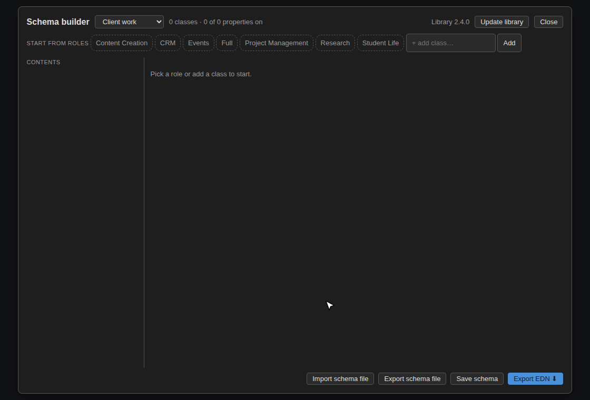

# Ontology Schema Builder

Set up classes and properties in your Logseq DB graph without building them by hand. Start from ready-made Schema.org roles such as CRM or Project Management, keep only what you need, and import the result with Logseq's own importer.

**Works with:** Logseq desktop 2.0.x and DB graphs. File-based (markdown) graphs are not supported.

## Install

1. Download `logseq-ontology-sync-plugin-vX.Y.Z.zip` from the [latest release](https://github.com/C0ntr0lledCha0s/logseq-ontology-sync-plugin/releases/latest).
2. Unzip it.
3. In Logseq, open **Settings -> Plugins**, turn on **Developer mode**, click **Load unpacked plugin**, and select the unzipped `logseq-ontology-sync-plugin` folder.

## Build a schema

A *role* is a ready-made set of classes and properties for one job or area of your life, such as CRM, Project Management, Events or Research. A *schema* is what you build from one or more roles: the classes and properties you want in your graph.

Open the builder from the toolbar icon, or run **Ontology: Open schema builder** from the Command Palette.

1. **Create a schema.** Choose **New schema…** from the schema picker and give it a name.
2. **Start from roles.** Click one or more role chips. Your schema gets everything from every role you pick.
3. **Trim it.** Untick the classes you don't want, and the properties you don't want on each class. Use **+ add class…** to add a class that isn't in your roles. Labels show where each item came from: a role, or added by you.
4. **Save schema.** Your schemas are saved in the graph, so you can come back and change them later.
5. **Export EDN.** The plugin saves an `.edn` file to your Downloads folder.
6. **Import it.** In Logseq choose **Import -> EDN to DB Graph** and select that file.

## Share a schema

Click **Export schema file** to save the schema as a `.json` file. In another graph, click **Import schema file** to load it. Files exported as roles by earlier versions still import.

## Before you export: conflicts

The plugin checks your schema against the properties already in your graph. If a property exists with a different type, or allows one value where the schema allows many (or the other way around), export is blocked and the clashes are listed. Change the property in Logseq, or untick it in the schema, then export again.

## Things to know

- **Importing never removes anything.** If you untick items after you've already imported a schema, importing again won't delete them. Remove them by hand in Logseq. The plugin warns you when this applies.
- **The schema library is downloaded from GitHub.** The first time you open the builder it needs an internet connection. After that it uses a saved copy. Click **Update library** to get the newest roles. The button highlights when a newer version is available.
- **Upgrading from the role builder.** Earlier versions called a schema a *role*. Your saved roles appear as schemas, and each moves to the new hidden *Ontology Schemas* page the next time you save it.
- **Nothing changes until you import.** The plugin only writes files. Your classes and properties change only when you import the EDN file in Logseq.

## Help and feedback

Report problems or ideas on the [issue tracker](https://github.com/C0ntr0lledCha0s/logseq-ontology-sync-plugin/issues). Please include your Logseq version and the plugin version.

See what's new in the [changelog](CHANGELOG.md). Developer notes are in [DEVELOPMENT.md](https://github.com/C0ntr0lledCha0s/logseq-ontology-sync-plugin/blob/main/DEVELOPMENT.md).

## License

MIT. See [LICENSE](LICENSE).
